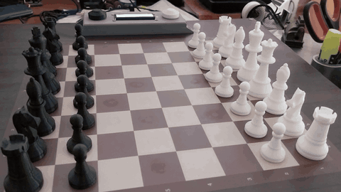
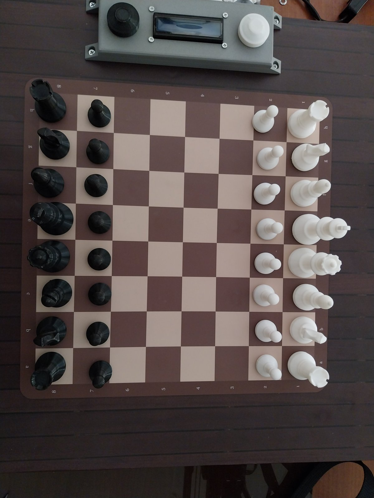
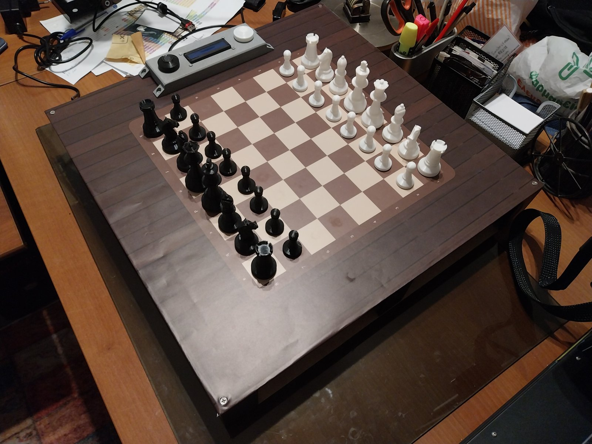
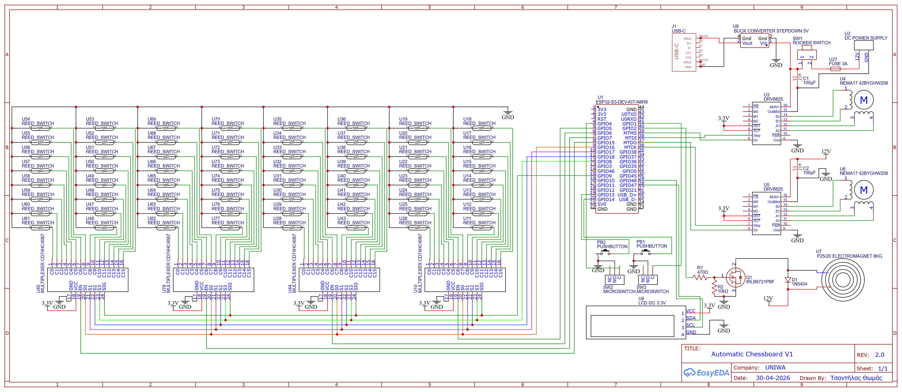
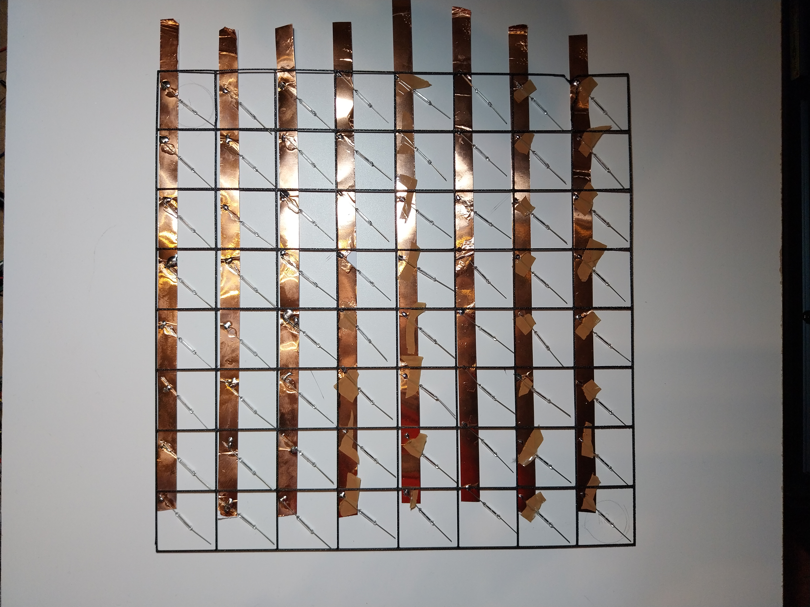
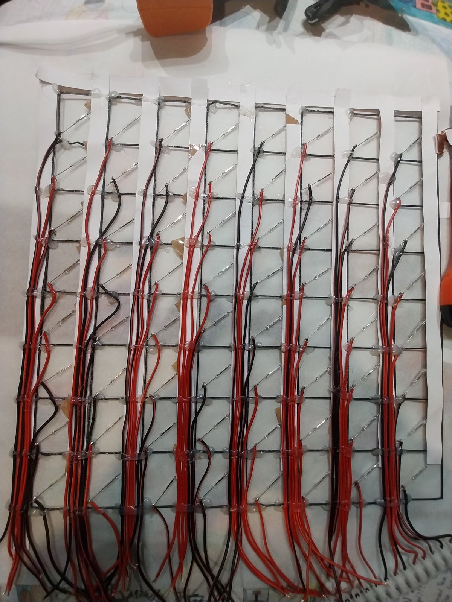
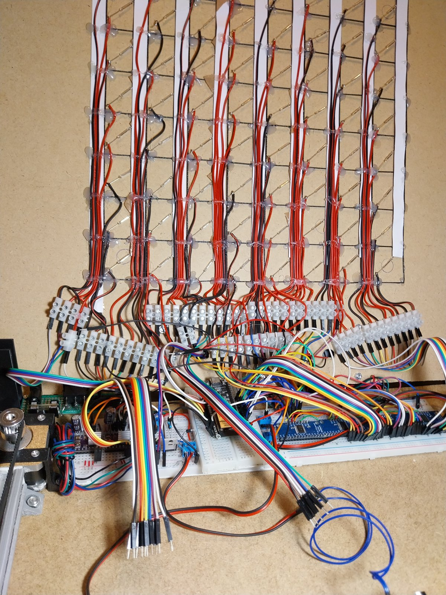
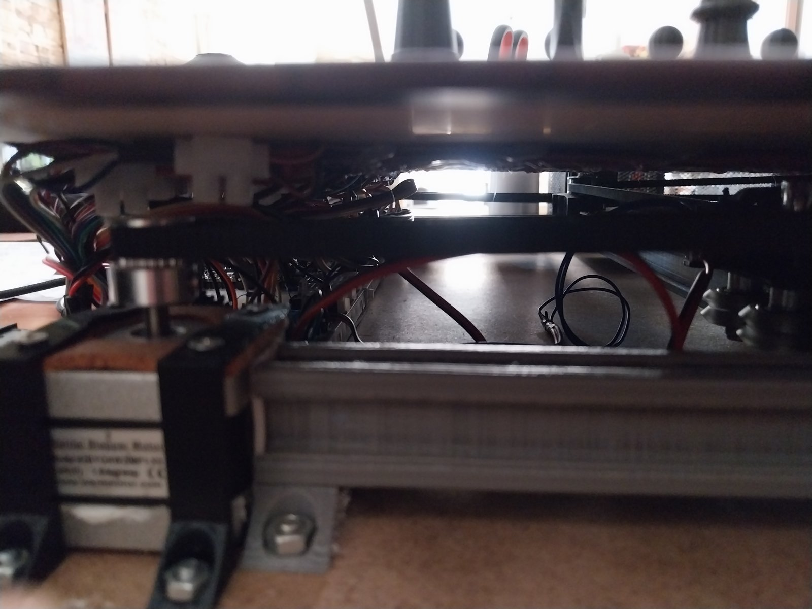

# Automated Robotic Chessboard

A self-contained chessboard that **detects your move, chooses a reply with a neural network running on a microcontroller, and physically moves its own pieces** with an electromagnet on a CoreXY gantry. No PC or internet needed during play.

Built as my Master's thesis (Integrated MSc, Industrial Design & Production Engineering, University of West Attica, 2026).

  

 

30-second demo video: [`docs/media/demo_first_moves.mp4`](docs/media/demo_first_moves.mp4)

## How it works

| Pillar | What happens | Key details |
|---|---|---|
| **Perception** | Detects the human move | 64 reed switches read through 4 x CD74HC4067 multiplexers every 50 ms; debounced 3-state detector (idle / piece in air / settling, 350 ms window); own legal-move generator rejects impossible reads |
| **Processing** | Chooses the reply | 6.75 M-parameter residual CNN, INT8, running on TensorFlow Lite Micro; output is filtered to legal moves |
| **Motion** | Moves the piece | CoreXY gantry, 2 x NEMA17 + DRV8825, FastAccelStepper (hardware pulse generation), limit-switch homing; planner compares 3 candidate routes and relocates blocking pieces; handles captures, castling and auto-queen promotion |

Safety: both buttons together trigger a debounced emergency stop (polled every 5 ms during motion).

## Numbers

| | |
|---|---|
| Model | 6,751,536 parameters, 6 residual blocks x 64 channels, input 8x8x18, output 4096 (from x 64 + to) |
| Size | 27 MB float -> **6.9 MB INT8** (fits the 8 MB flash together with the firmware) |
| Inference on ESP32-S3 | **about 500 ms** with the model copied to PSRAM, vs about 950 ms executing from flash |
| Training data | 5,000,000 positions extracted from the Lichess evaluation database (19 GB, Stockfish-evaluated) |
| Training | 4.75 M train / 250 k validation, 20 epochs, RTX 3060, 53.8 min |
| Validation accuracy | **37.3 % top-1, 79.5 % top-5** (matching Stockfish's best move) |
| Firmware | about 2,100 lines of C++ (plus extensive comments), custom 8 MB partition table with core-dump partition |
| Cost | about 213 EUR of parts (see BOM) |

**How to read the accuracy:** the labels are Stockfish's best move, and many positions have several good moves, so top-1 is naturally modest. The goal was a plausible, human-level opponent, not a perfect one. Playing strength has **not** been formally rated; the design target was roughly club level (about 1500 Elo).

Details of the data pipeline and training are in [`ml/`](ml/README.md).

## Hardware

Schematic (EasyEDA): [`electronics/schematic.png`](electronics/schematic.png)

| Function | ESP32-S3 GPIO |
|---|---|
| Stepper 1 STEP / DIR | 41 / 42 |
| Stepper 2 STEP / DIR | 39 / 40 |
| Limit switches X / Y | 1 / 4 |
| Electromagnet (via IRLB8721 MOSFET) | 2 |
| Mux select S0-S3 | 16, 17, 18, 8 |
| Mux enable (x4) | 5, 6, 7, 15 |
| Mux signal | 9 |
| I2C LCD 16x2 (0x27) SDA / SCL | 47 / 48 |
| Buttons White / Black | 13 / 14 |
| RGB status LED | 38 |

3D-printable parts (frame, trolley, mounts, UI enclosure, pieces) are in [`cad/`](cad/). The bill of materials: [`BOM`](electronics/BOM.csv) 

### Build photos

More in [`docs/images/`](docs/images/) (named by build phase).

## Build and flash

Open `firmware/AutoChessboard/AutoChessboard.ino` in the Arduino IDE. Settings that matter (the firmware stops with an error if PSRAM is off):

- Board: **ESP32S3 N8R8 Dev Module**, Flash 8 MB, **PSRAM: OPI PSRAM**
- Partition scheme: custom, using `partitions.csv` from the sketch folder
- Libraries: FastAccelStepper@1.2.5, LiquidCrystal_I2C@2.0.0, TensorFlow Lite Micro for ESP32@3.3.7

## Train your own model

See [`ml/README.md`](ml/README.md): five numbered scripts from raw Lichess data to the C array included in the sketch.

## Design decisions

- **TFLite Micro instead of ESP-DL.** I first quantized with ESP-PPQ to the `.espdl` format, but ESP-DL targets ESP-IDF and has no Arduino support, so I converted ONNX -> TFLite instead (the attempt is kept in `ml/experiments/espdl/`).
- **Model in PSRAM.** Running inference straight from flash was slow (about 950 ms); copying the 6.9 MB model to PSRAM brought it to about 500 ms.
- **Custom partition table.** The default Arduino layouts leave too little app space for firmware plus model, so the app partition is 7.9 MB with a small core-dump partition for post-mortem debugging.
- **Reed switches, knowingly.** They avoid a custom PCB, but they are binary and neighbouring fields overlap. That is the weakest subsystem, so the firmware validates every detected move in software before acting on it.

## Lessons learned

- Heavy motor and electromagnet switching corrupted the I2C bus, so the LCD is re-initialised at the start of every game.
- The emergency-stop flag is reset only *after* homing completes, so an EMI spike during homing cannot freeze the main loop.
- Sensor noise needed a settle window and debouncing before a lifted-and-placed piece counted as a move.
- Slow down trolley inside the perimeter to protect fragile limit switches from high-speed impact.

## Known limitations and roadmap

Hardware (v2): Hall-effect sensors instead of reed switches, metal beams and quieter drivers (TMC2209), a PCB instead of breadboards, removable magnets so any piece set works.

Firmware (what I would change next):
- Replace Arduino `String` with fixed-size buffers in the move pipeline (avoids heap fragmentation on long games)
- Split the single sketch into modules (rules engine, sensing, motion, UI) and unit-test the rules engine on a PC
- Make button handling non-blocking, like the move detector already is

## Credits and AI assistance

Lichess open database (CC0), Stockfish, python-chess, FastAccelStepper, TensorFlow Lite Micro. I used LLMs (Claude, Gemini) for some helper scripts, debugging help and code comments; the design, integration and testing are my own work, and the thesis documents this in a dedicated chapter.

Thesis (Greek, 202 pages): [`PDF`](docs/thesis_el.pdf) - Supervisor: Avraam Chatzopoulos

## License

GPL-3.0, see [`LICENSE`](LICENSE).
