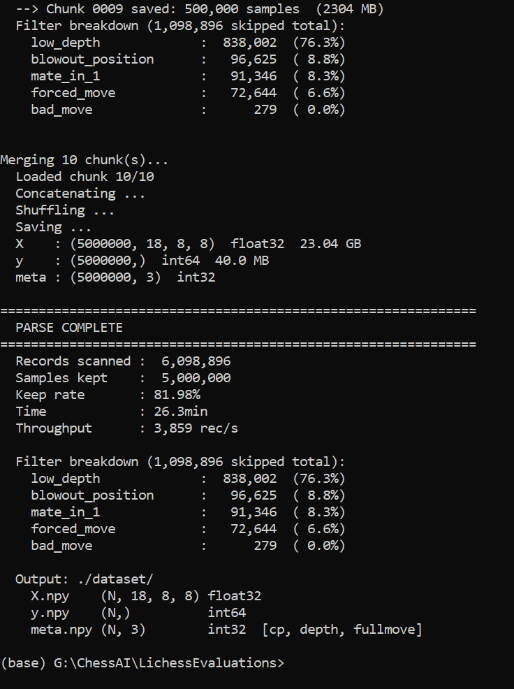
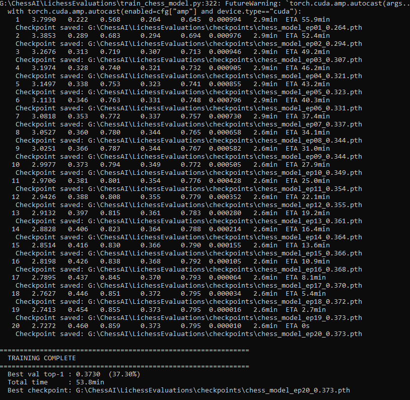

# Machine-learning pipeline

Everything needed to go from the raw Lichess database to the INT8 model that runs on the ESP32-S3.



| Stage | Script | Input | Output | Environment |
|---|---|---|---|---|
| 1. Extract training data | `01_parse_lichess_evals.py` | `lichess_db_eval.jsonl.zst` (19 GB, Stockfish-evaluated positions) | `X.npy` (N×18×8×8 bitplanes), `y.npy` (move = from×64+to), `meta.npy` | train |
| 2. Train | `02_train_chess_model.py` | the three `.npy` files | `.pth` checkpoints | train |
| 3. Export | `03_export_onnx.py` | best checkpoint | `models/chess_model.onnx` (27 MB) | train |
| 4. Quantize | `04_convert_to_tflite.py` | ONNX + `calib_data.npy` (500 calibration positions) | `models/chess_model.tflite` (6.9 MB, INT8) | tflite |
| 5. Embed | `05_tflite_to_header.py` | `.tflite` | `chess_model_data.h` (C array for the sketch) | train |
| Test on PC | `play_chess.py`, `play_chess_tf.py` | model | pygame UI to play against the float or INT8 model | train / tflite |

## What the first run actually did

- Scanned **6,098,896** records of the Lichess evaluation file and kept **5,000,000** (stopped once the target was reached).
- Filters: Stockfish depth >= 20, |eval| <= 10 pawns, at least 2 legal moves; dropped forced moves, mate-in-1 and "blowout" positions.
- Split 4.75 M train / 250 k validation. 6,751,536 parameters (6 residual blocks, 64 channels). Batch 2048, mixed precision, 20 epochs, **53.8 min on an RTX 3060**.
- Best validation: **37.3 % top-1, 79.5 % top-5** (agreement with Stockfish's best move).



## Running it

```bash
# environment 1
pip install -r requirements-train.txt
python 01_parse_lichess_evals.py --input lichess_db_eval.jsonl.zst --output_dir ./dataset --max_samples 5000000
python 02_train_chess_model.py
python 03_export_onnx.py

# environment 2
pip install -r requirements-tflite.txt
python 04_convert_to_tflite.py
python 05_tflite_to_header.py
```

**Known rough edge:** scripts 02-05 still contain absolute Windows paths (`G:\ChessAI\LichessEvaluations\...`) in their configuration block at the top. Edit them before running. `calib_data.npy` is a sample of 500 positions from `X.npy`. TODO: add the one-liner used to create it.

## Experiments kept for the record

`experiments/espdl/` holds my first deployment attempt: quantizing with ESP-PPQ to Espressif's `.espdl` format. ESP-DL targets ESP-IDF and has no Arduino support, so I switched to TensorFlow Lite Micro for the final board. `patch_espdl.py` works around an ESP-PPQ export hang with large models.

The flowchart of the whole pipeline is in `../docs/ml_pipeline_flowchart.html`.
